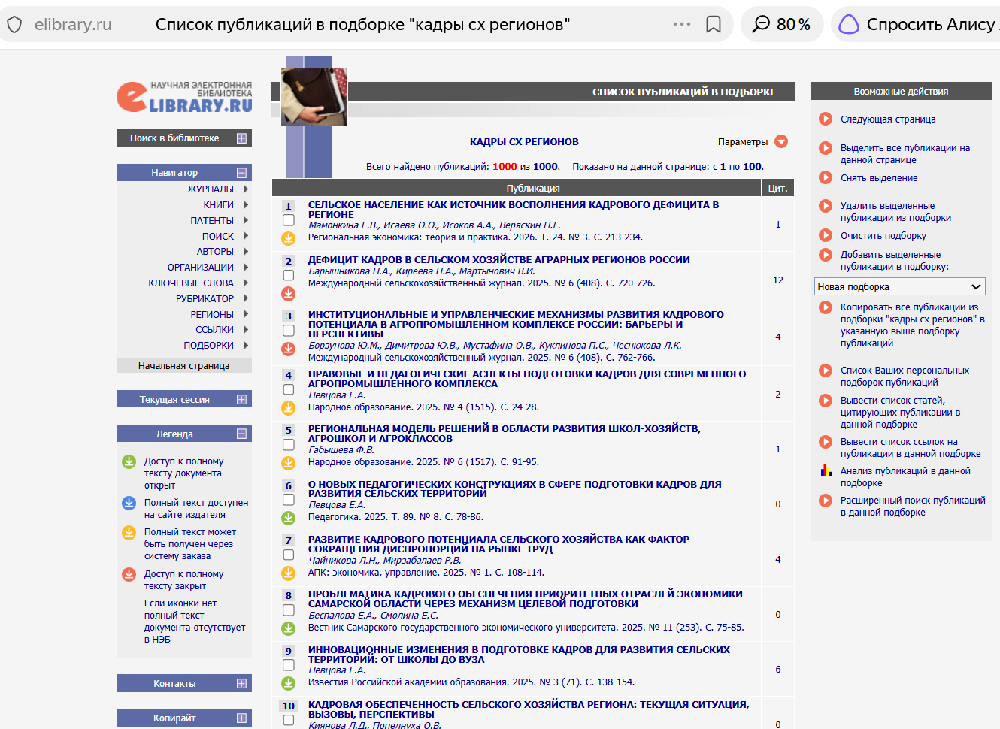
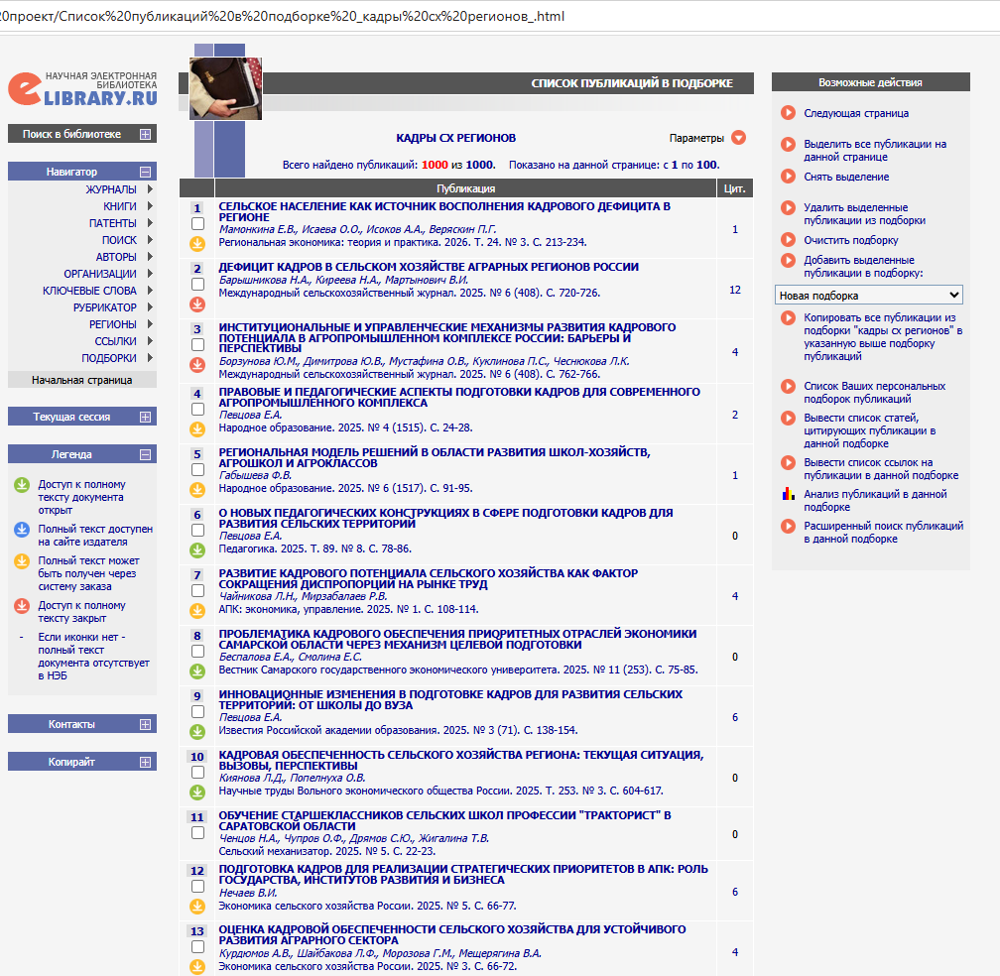
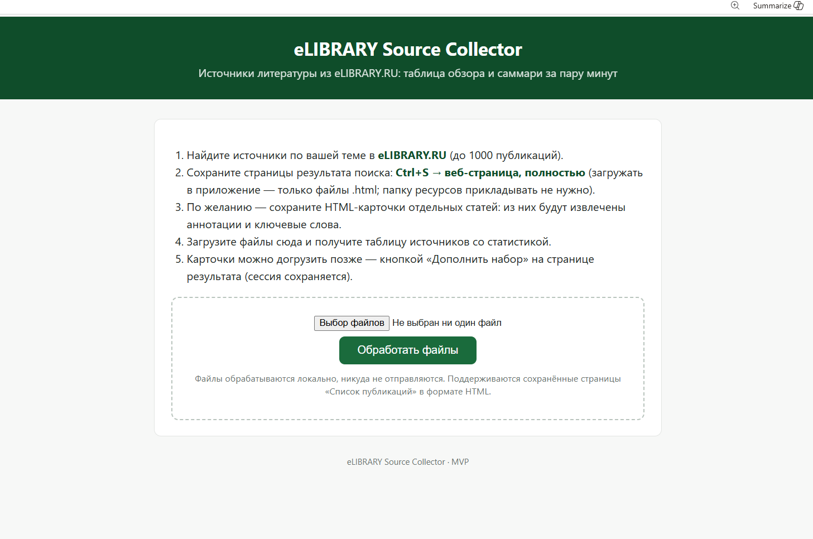
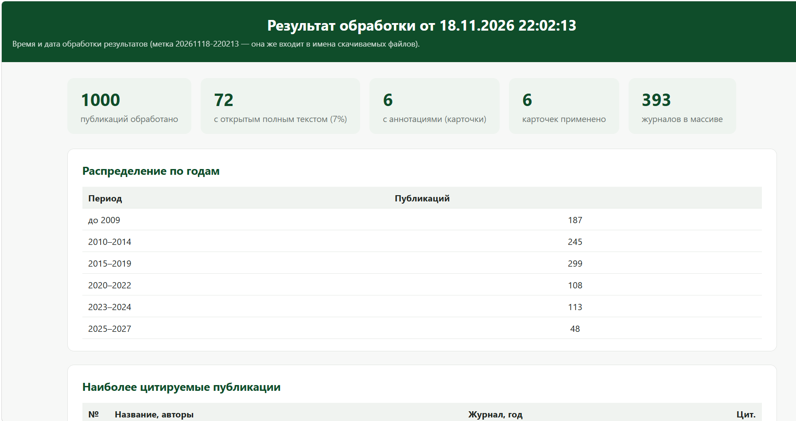
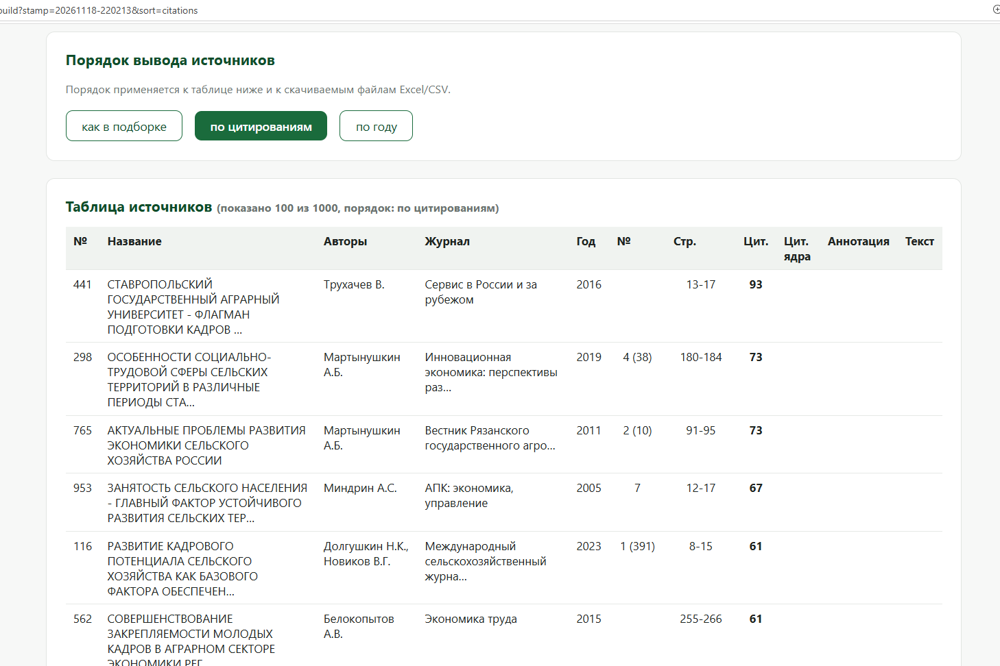
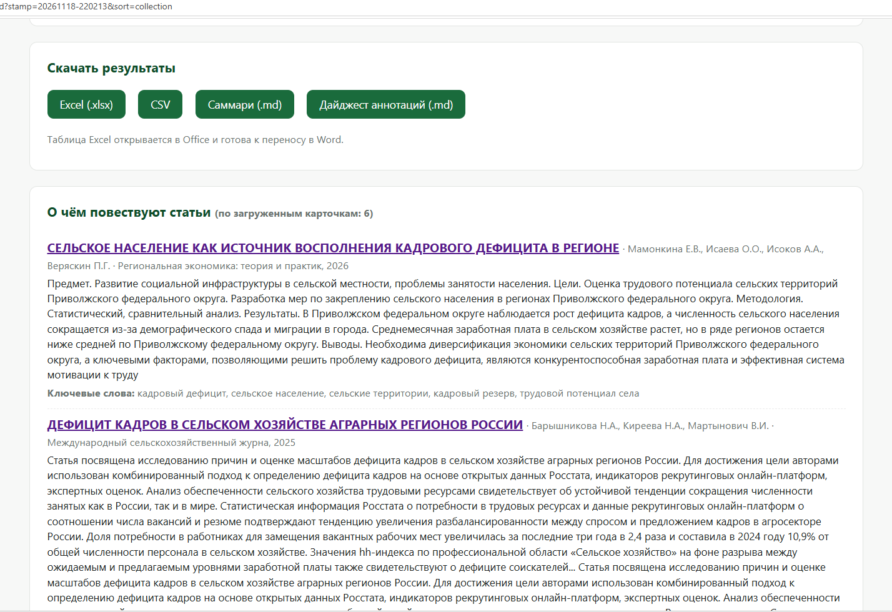
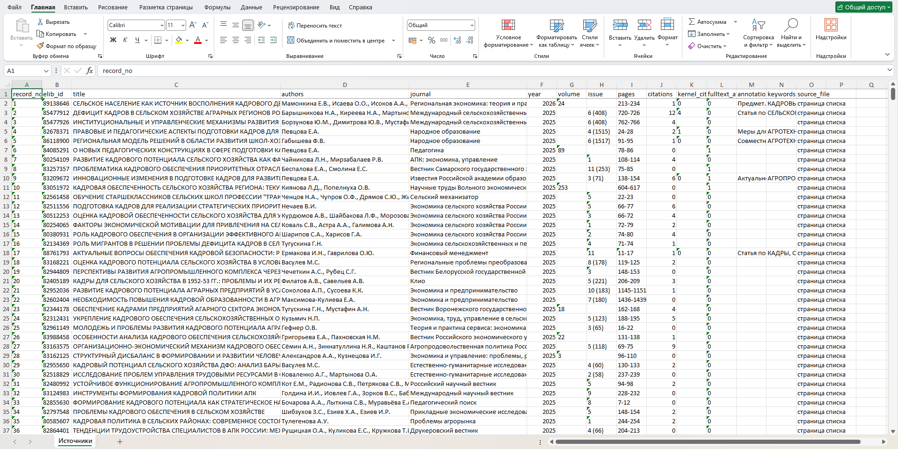
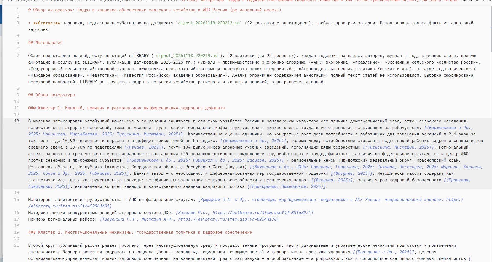

# eLIBRARY Source Collector

**eLIBRARY Source Collector** — локальный инструмент, который собирает источники литературы на заданную тему из [eLIBRARY.RU](https://elibrary.ru/) (до 1000 источников) и готовит таблицу обзора и саммари.

## Зачем это нужно

Поиск в eLIBRARY источников литературы на заданную тему даёт сотни записей, и вся содержательная обработка — авторы, релевантность теме и актуальность, сортировки, оценка цитируемости (в том числе по ядру РИНЦ), оформление таблицы — выполняется вручную и отнимает часы и дни на каждый литературный обзор.

Инструмент превращает сохранённые страницы результатов поиска в структурированную таблицу со статистикой за пару минут — для научных сотрудников, консультантов, аналитиков, студентов, аспирантов и преподавателей.

## Как это работает

1. Вы ищете источники по теме в eLIBRARY.RU как обычно.
2. Сохраняете страницы результата поиска: **Ctrl+S → «Веб-страница, только HTML»** (по желанию — и карточки отдельных статей).
3. Загружаете файлы в интерфейс — получаете:
   - **таблицу источников** (Excel/CSV): название, авторы, журнал, год, том/номер, страницы, цитирования и цитирования по ядру РИНЦ, отметки открытого доступа и аннотаций;
   - **саммари**: распределение по годам и журналам, топ-15 цитируемых публикаций, выводы по массиву;
   - **дайджест аннотаций**: «о чём повествуют статьи» по загруженным карточкам — суть каждой публикации и ссылка на неё в eLIBRARY, частотная тематика массива.
4. Карточки можно **догрузить позже** — блок «Дополнить набор» на странице результата добавляет файлы к той же сессии и пересобирает результаты (полный перезагруз не нужен).

## Быстрый запуск

Требуется Python 3.10+ ([python.org](https://www.python.org/downloads/)).

```bash
pip install flask openpyxl
python app.py
```

Затем откройте в браузере: **http://127.0.0.1:5000**

> Приложение работает полностью локально: загруженные файлы никуда не отправляются.

## Пользовательский сценарий

| Шаг | Действие | Результат |
|---|---|---|
| 1 | Открыть http://127.0.0.1:5000 | Стартовый экран с инструкцией |
| 2 | Выбрать сохранённые HTML-страницы поиска (можно все сразу, до 10 страниц × 100 записей) | — |
| 3 | Нажать «Обработать файлы» | Страница результата: показатели, статистика, таблица |
| 4 | Выбрать порядок вывода: «как в подборке», «по цитированиям», «по году» | Перестраивается таблица и скачиваемые файлы |
| 5 | Скачать Excel / CSV / саммари | Таблица открывается в Office, готова к переносу в Word |

Карточки статей (HTML с аннотацией) распознаются автоматически: вместе с таблицей из них извлекаются аннотации, ключевые слова и цитирования по ядру РИНЦ.

## Как это выглядит

Сквозная серия снимков — путь от запроса до обзора (полный набор с пояснениями — в [`screenshots/README-screenshots.md`](screenshots/README-screenshots.md)):

**1. Поиск источников в eLIBRARY.RU — подборка по теме, 1000 публикаций**



**2. Страницы результата сохраняются стандартно: Ctrl+S → «Веб-страница, только HTML»**



**3. Стартовый экран приложения: инструкция и загрузка файлов**



**4. Результат — показатели массива и распределение по годам**



**5. Таблица источников в порядке «по цитированиям»**



**6. Скачивание таблицы, саммари и дайджест аннотаций**



**7. Итоговая таблица в Microsoft Excel — готова к переносу в Word**



**8. Полный цикл «источники → обзор»: обзор литературы, подготовленный субагентом по дайджесту аннотаций**



## Ограничения MVP и планы

Реализовано (MVP):
- парсинг страниц «Список публикаций» eLIBRARY (устойчив к записям без страниц/авторов и смешанной кодировке);
- обогащение из карточек статей; догрузка карточек в существующую сессию («Дополнить набор»);
- саммари по массиву; дайджест аннотаций с ссылками на публикации;
- вывод CSV + Excel + саммари (.md) + дайджест (.md); выбор порядка вывода.

Планируется:
- обзор литературы по всему массиву, подготовленный ИИ-субагентом по дайджесту аннотаций (сейчас такой обзор готовится во время работы в Claude Code — субагент-райтер пишет его по файлу дайджеста; задача — встроить шаг в основной сценарий приложения);
- поддержка других источников публикаций с сохранёнными страницами (в первую очередь ResearchGate);
- экспорт списка литературы в формате ГОСТ;
- поддержка PDF-версии списка публикаций.

## Структура проекта

```
├── app.py                  # веб-приложение (Flask)
├── templates/              # страницы интерфейса
├── scripts/
│   ├── elib_list_parser.py # парсер HTML-списков публикаций
│   ├── elib_summary.py     # вычисление и формат саммари
│   └── dev/                # диагностические скрипты
├── data/
│   ├── raw/                # сырые сохранённые страницы (локальные данные, вне git)
│   └── processed/          # таблицы и саммари — результаты работы
├── tmp/                    # временные загрузки (локальные данные, вне git)
├── screenshots/            # серия скриншотов демонстрации (по разделам сценария)
└── docs/                   # описание проекта
```

## Важно о приватности

Приложение работает полностью локально: загруженные файлы никуда не отправляются и обрабатываются только на вашем компьютере — временные загрузки хранятся в `tmp/`, результаты — в `data/processed/`. Сохранённые страницы eLIBRARY содержат служебные данные вашей сессии (имя пользователя, SPIN-код, IP), поэтому никуда выкладывать их не стоит: при самостоятельной публикации проекта каталоги `data/raw/` и `tmp/` исключены из репозитория.

## Технологии

- **Python 3.12**, стандартная библиотека (`re`, `csv`, `html`, `argparse`)
- **Flask** — веб-интерфейс
- **openpyxl** — вывод в Excel
- Форматы: HTML (вход), CSV (UTF-8-BOM), XLSX, Markdown (выход)
